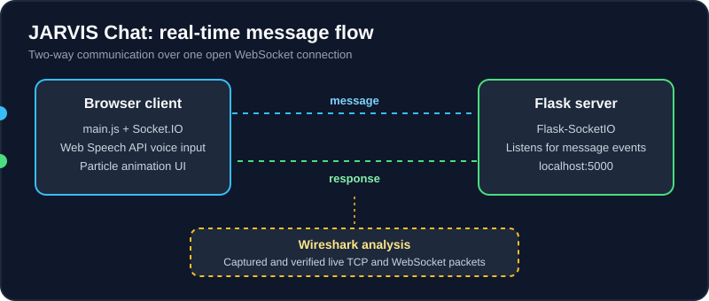
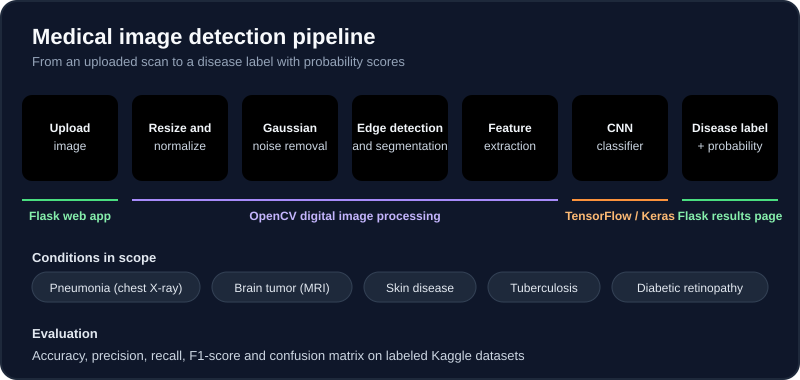

 

📍 **Islamabad, Pakistan** &nbsp;·&nbsp; 🎓 **BS Computer Science, Air University Islamabad (2023 – 2027)**

---

## 👨‍💻 About me

I'm a full stack software developer who has delivered **17+ end-to-end projects** across web development, mobile applications, data engineering, AI/ML systems and systems programming. I design scalable solutions on relational and NoSQL databases, build real-time communication systems with WebSockets, and develop AI-powered applications. I care about clean, maintainable code and finished, high-quality software.

**Languages I work in:**

**Frontend and mobile:**

**Backend and APIs:**

**Databases:**

**AI / ML and image processing:**

**Security, data and tools:**

---

## 📈 My work at a glance

  

---

# 🚀 Flagship project

## 🥖 GramSure: Intelligent Bakery Management System
**Final Year Project · Full Stack Lead of a 3-member team**

**The problem it solves.** Bakery owners who cannot be on site every day often cannot tell whether the raw material they buy turns into the products and revenue it should. GramSure links raw material purchased to expected production output and revenue, giving remote owners full visibility from a phone or a computer.

**What I built and led**
- Led a 3-member team as Full Stack lead.
- Designed a modular system of **12 interoperable modules**: recipe standards, procurement, inventory (FIFO), production batches, sales reconciliation, expenses, staff attendance, live P&L dashboard, fraud detection, demand forecasting, owner notification center and multi-branch management.
- Built the **Recipe & Standards Engine**, which defines the standard for what each product should consume and produce.
- Built **Production & Batch Management**, including yield variance detection with a **2% tolerance band**.
- Built the **AI Fraud Detection & Anomaly Engine** with **Isolation Forest and LSTM** models and per-employee suspicion scoring, benchmarked against rule-based methods.
- Applied **Facebook Prophet** to demand forecasting.
- Built the **Remote Owner Control & Notification Center** and integrated **WhatsApp Business API** alerts.
- Secured the platform with **JWT and role-based access control** for four roles: Owner, Manager, Staff and Auditor.
- Designed an **icon-first, Urdu-supported staff interface** for low-literacy users.

**Skills demonstrated:** team leadership, system design, full stack development on web and mobile, time-series storage, machine learning for anomaly detection and forecasting, access control, user-centered design.

[**View GramSure repository →**](https://github.com/AdnannIrfan/REPO-GRAMSURE)

---

# 📂 Projects

## 🤖 JARVIS Chat: Real-Time AI Chat Web Application

**Overview.** A real-time chat application where a browser client and a server talk to each other in both directions over WebSockets.

**Key features**
- Server built with Flask and Flask-SocketIO that listens for `message` events and emits `response` events in real time on localhost:5000.
- Client written in JavaScript (`main.js`) with Socket.IO integration, handling user input and message display.
- Voice input through speech recognition with the Web Speech API.
- A visually striking interface with a glowing particle animation canvas, a responsive chat display and microphone input.
- Network analysis in Wireshark that captured and verified live TCP and WebSocket packet traffic during a chat session.

**Skills demonstrated:** socket programming, event-driven messaging, real-time web development, browser APIs, network traffic analysis.

[View repository →](https://github.com/AdnannIrfan/REPO-JARVIS-CHAT)

## 🗃️ JARVIS Chat: Database Schema Design

**Overview.** A fully normalized (3NF) relational schema that backs the JARVIS Chat AI assistant, created for a Database Systems course.

**Key features**
- 12 core entities: JarvisUsers, WeatherSearchLog, NewsRequests, JarvisTasks, SystemLogs, JarvisNotes, CalendarEvents, Alarms, Alerts, Settings, Devices and CommandLogs.
- Referential integrity enforced through foreign keys (UserId, DeviceId) with one-to-many associations across all modules.
- Atomic attributes, with partial and transitive dependencies eliminated.
- CreatedAt/Timestamp columns on every action table for audit trails.
- Built for growth: modular tables that allow User Roles, Device Types, TaskStatusHistory and soft-delete flags later.

**Skills demonstrated:** relational modeling, normalization, entity-relationship design, data integrity, scalable schema planning.

[View repository →](https://github.com/AdnannIrfan/REPO-JARVIS-DB)

## 🩺 AI-Based Medical Image Disease Detection System

**Overview.** A web-based AI system for automated disease detection from chest X-rays, brain MRI scans and skin images.

**Key features**
- Digital image processing with OpenCV: resizing, normalization, Gaussian noise removal, edge detection, image segmentation and feature extraction.
- A Convolutional Neural Network built in TensorFlow/Keras for supervised classification, trained on labeled Kaggle medical datasets.
- Model evaluation with accuracy, precision, recall, F1-score and a confusion matrix.
- A multi-page Flask web app with an image upload interface, a results page showing the disease label and probability scores, and visual output.
- Scope covers pneumonia (chest X-ray), brain tumor (MRI), skin disease, tuberculosis and diabetic retinopathy detection.

**Skills demonstrated:** computer vision, deep learning, model evaluation, ML deployment through a web interface.

[View repository →](https://github.com/AdnannIrfan/REPO-MEDICAL-IMAGE-AI)

## 🎓 Faculty Portal: University Management System

**Overview.** A full-featured university portal where faculty manage their courses, grades and student records.

**Key features**
- Course management, grade management and student record management for faculty.
- Blazor server-side rendering for a responsive interface.
- Integrated SQL Server backend for secure, real-time data access.

**Skills demonstrated:** full stack development with .NET, server-side rendering, relational database integration.

[View repository →](https://github.com/AdnannIrfan/REPO-FACULTY-PORTAL)

## 👔 Employee Management System

**Overview.** An enterprise-grade HR system that covers the daily work of managing employees.

**Key features**
- Modules for employee records, payroll tracking and attendance management.
- Role-based access control.
- Full CRUD operations across every HR module.
- A polished, responsive interface.

**Skills demonstrated:** enterprise application design, access control, CRUD workflows, SQL Server data modeling.

[View repository →](https://github.com/AdnannIrfan/REPO-EMPLOYEE-MANAGEMENT)

## 🎮 GameVerse: Gaming Platform Application

**Overview.** An interactive gaming portal built on the .NET Blazor framework.

**Key features**
- User authentication.
- Game cataloguing backed by an integrated SQL Server database.
- A modern, polished frontend interface.

**Skills demonstrated:** authentication flows, catalogue design, Blazor UI development.

[View repository →](https://github.com/AdnannIrfan/REPO-GAMEVERSE)

## 🛡️ Women Safety Application

**Overview.** A cross-platform mobile safety app built to help users in emergencies.

**Key features**
- Real-time location sharing.
- SOS alerts.
- Emergency contact management.
- Firebase Realtime Database for live data sync and Firebase Authentication for secure user management.

**Skills demonstrated:** cross-platform mobile development, real-time data sync, authentication, safety-focused product design.

[View repository →](https://github.com/AdnannIrfan/REPO-WOMEN-SAFETY)

## 🍳 Chef Mate AI: AI-Powered Cooking Companion

**Overview.** An AI-powered cooking assistant mobile app that suggests recipes based on the ingredients a user already has.

**Key features**
- Recipe suggestions from available ingredients.
- Favorite recipe storage.
- Step-by-step cooking guidance.
- Firebase-backed persistence of user data.

**Skills demonstrated:** AI-assisted features in a mobile app, Flutter UI, cloud data persistence.

[View repository →](https://github.com/AdnannIrfan/REPO-CHEF-MATE-AI)

## 🔑 Secure Authentication with Multi-Factor Authentication (MFA)

**Overview.** An information security project that demonstrates secure login flows and defense against unauthorized access.

**Key features**
- TOTP-based multi-factor verification.
- Secure session management.
- Encrypted credential storage.

**Skills demonstrated:** authentication security, session handling, secure credential storage.

[View repository →](https://github.com/AdnannIrfan/REPO-MFA-AUTH)

## 🧭 AI Pathfinding Visualizer: Data Structures and Algorithms

**Overview.** A visual implementation of AI pathfinding algorithms with a custom-built GUI.

**Key features**
- A* and Dijkstra implementations.
- Real-time graph traversal you can watch run.
- A direct comparison of heuristic and non-heuristic approaches and their performance.

**Skills demonstrated:** graph algorithms, algorithmic efficiency, C++ GUI development.

[View repository →](https://github.com/AdnannIrfan/REPO-PATHFINDING-CPP)

## 🗺️ AI Pathfinding Web Application

**Overview.** The web version of the pathfinding visualizer, running on a Python Flask backend.

**Key features**
- Interactive map inputs.
- Animated algorithm execution in the browser.

**Skills demonstrated:** porting algorithms to the web, Flask backend development, interactive visualization.

[View repository →](https://github.com/AdnannIrfan/REPO-PATHFINDING-WEB)

## 💬 Real-Time Chat Application

**Overview.** A real-time web chat application with persistent history.

**Key features**
- User authentication.
- Chat rooms.
- Persistent message storage in SQL Server.

**Skills demonstrated:** real-time web development, authentication, relational database persistence.

[View repository →](https://github.com/AdnannIrfan/REPO-REALTIME-CHAT)

## 📊 Sales ETL Pipeline

**Overview.** An end-to-end Extract, Transform, Load pipeline for sales data processing.

**Key features**
- Data extraction from the source.
- Data cleaning and transformation logic.
- Loading into a structured data store ready for analytics.

**Skills demonstrated:** data engineering, data cleaning, ETL design.

[View repository →](https://github.com/AdnannIrfan/REPO-SALES-ETL)

## 🌦️ Weather Data Pipeline

**Overview.** An automated data pipeline that turns live public weather data into stored, analysis-ready records.

**Key features**
- Fetches live weather data from public APIs.
- Transforms the data.
- Persists it for analytics and reporting.

**Skills demonstrated:** API integration, automated pipelines, data transformation and storage.

[View repository →](https://github.com/AdnannIrfan/REPO-WEATHER-PIPELINE)

## ☁️ Cloud-Based Operating System Simulation

**Overview.** A low-level systems programming project that simulates OS-level cloud operations in C.

**Key features**
- Process scheduling.
- Memory management.
- File system operations.

**Skills demonstrated:** operating system concepts, low-level C programming, resource management.

[View repository →](https://github.com/AdnannIrfan/REPO-CLOUD-OS-SIM)

## 🌐 ICT Responsive Web Project

**Overview.** A multi-page responsive website built for an Introduction to Communication and Technology course.

**Key features**
- Semantic HTML structure.
- Modern CSS layout techniques.
- Responsive pages that adapt to different screen sizes.

**Skills demonstrated:** semantic markup, responsive design, CSS layout.

[View repository →](https://github.com/AdnannIrfan/REPO-ICT-WEBSITE)

---

# 💼 Experience

## Software Development Intern
**National Engineering and Scientific Commission (NESCOM), Islamabad** · 2-month internship

- Contributed to software development tasks in an engineering and applied-research environment, working under object-oriented programming principles and structured software design practices.
- Assisted in developing, debugging and testing code modules, and maintained clear technical documentation throughout the development lifecycle.
- Collaborated with cross-functional engineering teams and used Git for version control, source tracking and collaborative development workflows.
- Gained practical exposure to system design and architecture for efficient, scalable, performance-driven applications.

# 🎓 Education

**Bachelor of Science in Computer Science (BSCS)**
Air University Islamabad · Islamabad, Pakistan · 2023 – 2027

---

# ⭐ Key strengths

- Multi-language, multi-stack development in C#, Python, JavaScript, Dart and C/C++
- 17+ completed end-to-end projects across web, mobile, AI/ML, data engineering and systems programming
- Real-time systems with WebSockets, Socket.IO and Flask-SocketIO
- AI and machine learning: CNN image classification, anomaly detection, A* and Dijkstra pathfinding
- Digital image processing with OpenCV: noise removal, edge detection, segmentation, feature extraction
- Database design across SQL Server, PostgreSQL, MongoDB and Firebase, with normalized schemas and ETL pipelines
- Cross-platform development with Flutter (Android/iOS) and Blazor .NET
- Information security and authentication: MFA, TOTP and secure session management
- Network analysis with Wireshark for packet capture and TCP/WebSocket verification
- Self-driven, quick learner who actively maintains a public GitHub portfolio

---

# 📊 GitHub activity

 

 

---

### 📫 Contact

**Muhammad Adnan Ali** · Islamabad, Pakistan

✉️ [stackshadow02@gmail.com](mailto:stackshadow02@gmail.com) &nbsp;·&nbsp; 🌐 [adnannirfan.github.io](https://adnannirfan.github.io) &nbsp;·&nbsp; 💻 [github.com/AdnannIrfan](https://github.com/AdnannIrfan)

